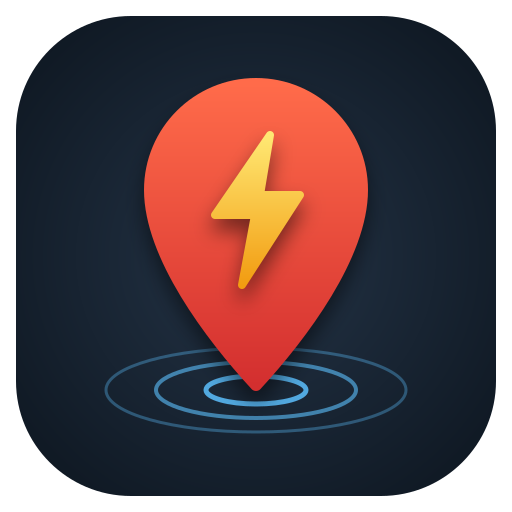

# GPS Trigger



App Android (dalla 15 in poi, compatibile dalla 8) che cambia le impostazioni del telefono quando entri in una zona e le ripristina quando esci.

Per ogni zona puoi impostare:

- volume della suoneria
- volume delle notifiche
- volume in chiamata
- modalità audio (suono, vibrazione o silenzioso)
- Wi‑Fi acceso o spento

Per ogni zona scegli anche:

- **In quali giorni della settimana è attiva.** Negli altri giorni l'ingresso viene ignorato.
- **La frequenza di controllo della posizione:** 1, 10, 20, 30 o 60 minuti.

La posizione si sceglie su una mappa OpenStreetMap, toccando la mappa o cercando un indirizzo. Non serve nessuna API key.

L'interfaccia è in inglese, e in italiano se il telefono è impostato in italiano.

Il tema chiaro o scuro segue il sistema. Puoi anche sceglierlo dall'icona impostazioni in alto nella lista zone. In tema scuro anche la mappa diventa scura.

L'icona originale è in `art/gps-trigger-icon.svg`. Le versioni Android sono in `app/src/main/res/drawable/ic_launcher_*.xml`:

- sfondo
- primo piano
- versione monocromatica per le icone a tema

## Compilare

Serve JDK 17 e l'Android SDK (platform 35). Su questo Mac sono installati con Homebrew:

```sh
export JAVA_HOME=/opt/homebrew/opt/openjdk@17/libexec/openjdk.jdk/Contents/Home
./gradlew assembleRelease
```

L'APK viene creato in `app/build/outputs/apk/release/app-release.apk`.

In alternativa puoi aprire la cartella con Android Studio.

Le build sono firmate con la chiave di debug di questo Mac (`~/.android/debug.keystore`). Per installare un aggiornamento sopra una versione già installata serve la stessa chiave, quindi conserva quel file.

## Installare sul telefono

1. Copia l'APK sul telefono e aprilo. Android chiederà di consentire l'installazione da quella sorgente.
2. Puoi anche usare il cavo USB con il debug USB attivo: `adb install -r app-release.apk`.
3. Se Play Protect segnala l'app come sconosciuta, scegli "Installa comunque".

## Primo avvio

La schermata principale mostra cosa manca da configurare:

1. **Posizione**: concedi l'accesso, poi in Impostazioni → Autorizzazioni → Posizione scegli **"Consenti sempre"**. Senza questa opzione le zone funzionano solo con l'app aperta.
2. **Accesso a Non disturbare**: serve per la modalità silenziosa e per cambiare i volumi quando Non disturbare è attivo.
3. **Notifiche** (facoltative): ricevi un avviso quando entri o esci da una zona.

Consigliato: in Impostazioni → App → GPS Trigger → Batteria scegli **"Senza restrizioni"**.

## Come funziona

- **Rilevamento delle zone.** Usa il geofencing di Google Play Services, che consuma poca batteria.
  - L'evento può arrivare con un ritardo di qualche minuto.
  - Un raggio di almeno 100–150 m dà risultati più affidabili.
- **Ingresso.** Quando entri in una zona, l'app salva lo stato attuale del telefono e applica le impostazioni della zona.
- **Uscita.** Quando esci, ripristina solo le impostazioni che la zona aveva cambiato.
  - Con zone sovrapposte, prevale l'ultima zona in cui sei entrato.
- **Frequenza di controllo.**
  - È il ritardo massimo con cui Play Services segnala ingresso e uscita (`setNotificationResponsiveness`).
  - Intervalli più lunghi fanno risparmiare batteria, ma vale sia per l'ingresso sia per l'uscita.
  - L'app non interroga mai il GPS per conto suo.
- **Giorni della settimana.**
  - Poco dopo mezzanotte l'app ricontrolla le zone.
  - Se sei dentro una zona e il nuovo giorno non è attivo, ripristina le impostazioni precedenti.
  - Se invece il nuovo giorno è attivo e sei dentro, applica le impostazioni della zona.
- **Prova senza muoverti.** Nella schermata di modifica di una zona ci sono i pulsanti "Simula ingresso" e "Simula uscita". "Simula ingresso" funziona anche nei giorni in cui la zona non è attiva.
- **Mappa e indirizzi.**
  - Mappa: tile OpenStreetMap, servono dati mobili o Wi‑Fi.
  - Ricerca indirizzi: usa il Geocoder di Android, quindi niente chiave.

## Perché targetSdk 28

Da Android 10 le app non possono più accendere o spegnere il Wi‑Fi. L'eccezione vale solo per le app dichiarate per Android 9 o precedenti, cioè con targetSdk 28. Per questo l'app usa targetSdk 28.

Su Android 15 l'app si installa e funziona normalmente. Le conseguenze sono due:

- Non può essere pubblicata sul Play Store.
- Android potrebbe mostrare l'avviso "app creata per una versione precedente".

## Limiti noti

- **Suoneria e notifiche collegate.** Su alcuni telefoni il volume delle notifiche è legato a quello della suoneria, e cambiarne uno cambia anche l'altro. È un comportamento del produttore.
- **Wi‑Fi con modalità aereo.** Se la modalità aereo è attiva, Android può ignorare la richiesta di accendere il Wi‑Fi.
- **Zone perse.** Dopo un riavvio o un aggiornamento le zone vengono registrate di nuovo in automatico. Lo stesso succede ogni 6 ore e a ogni apertura dell'app.
